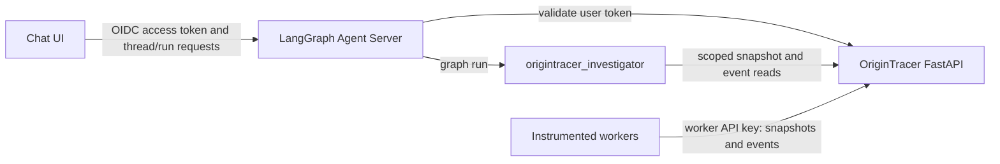

# Agentic Investigation

The OriginTracer Agent Server is an optional LangGraph application for product
questions and evidence-based investigations of workers. It complements the
React dashboard and REPL: the agent reads snapshots and events stored by
FastAPI, while the REPL queries a running process directly.

## What it does

- Answers OriginTracer product questions using the published documentation
  search index when it is available.
- Inspects reporting workers, their graphs, events, traces, hotspots, causal
  rules, and graph changes.
- Plans bounded reads, assesses findings against the request, cites evidence,
  and explains what remains uncertain.
- Continues conversations through LangGraph threads and checkpoints.
- Pauses for explicit approval before recording supported deployment markers
  or causal-rule evaluations.

The Agent Server exposes the LangGraph HTTP API and registers the graph as
`origintracer_investigator`. The Chat UI uses that API for thread and run
requests. A run supplies a worker PID; the agent resolves it to a stable
`worker_instance_id` and scopes its stored-data reads to that process instance.

## Authentication boundary

Users sign in through Keycloak. The Agent Server validates the short-lived user
access token through FastAPI and applies the user's identity to thread access.
Each user can create and use their own threads. Instrumented processes, including
the Agent Server itself, use separate worker API keys to upload snapshots and
events. A worker key is not a user's sign-in token; authenticated tool reads use
the caller's access token.

## Data flow

Rule matches and graph relationships are evidence for investigation, not proof
of cause. When the available stored data cannot distinguish explanations, the
report should keep that uncertainty explicit.

## Guides

- [Investigation flow](investigation-flow.md) covers worker identity, evidence
  collection, assessment, report construction, and approval.
- [Agent Server API](api.md) describes the HTTP contract used by clients and
  the authentication boundary.
- [Setup and operations](operations.md) covers configuration, startup, and
  direct API examples.
- [Python agent reference](../api/agent.md) covers the graph, tools, data
  models, and backend client symbols.
