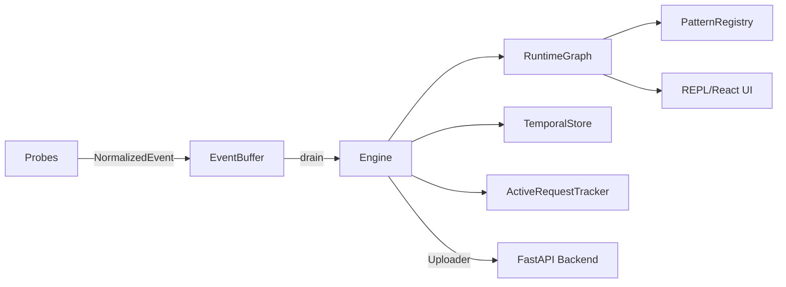

# OriginTracer

**Probe-based Python runtime observability.**

OriginTracer instruments the framework hooks - Django middleware, asyncio `Task.__step`, Gunicorn fork callbacks, Uvicorn ASGI middleware - and builds a live causal graph of your running stack from the signals they emit, and does not affect the code in your applications.

```
gunicorn::master  ── spawned ──>  gunicorn::UvicornWorker-24861
                  ── handled ──>  uvicorn::/api/users/
                  ── calls ──>    django::/api/users/
                  ── calls ──>   django::NPlusOneView  ×180
                  ── calls ──>    django::SELECT "auth_user"...  ×90
```

The N+1 pattern surfaces structurally - `NPlusOneView`has 180 calls, and the query has 90 - no query analysis needed.

---

## What it does

=== "Graph"
    Builds a live `RuntimeGraph` of your stack topology - nodes are services and routes, edges are causal relationships. The graph is built to converge after handling multiple requests; for example, in our testing, graphs could average: 24 nodes after 100 requests or even 100,000 requests.

=== "Rules"
    Evaluates causal rules against the graph to detect patterns like: loop starvation, N+1 database queries, retry amplification, worker imbalance, and more. Rules are plain Python predicates - you can write your own extensions in a `.py` file.

=== "REPL"
    A terminal REPL that queries the live engine via Unix socket designed for development. You can run commands like: `SHOW nodes`, `SHOW edges`, `CAUSAL`, `DIFF SINCE deployment`, `\stitch <trace_id>` - while your app runs for investigations.

=== "React UI"
    A browser dashboard that shows nodes, edges, trace timeline, event log, deployment diffs. It connects to the FastAPI backend and read data uploaded by the uploader - it does not interact with te in-memory causal graph.

=== "Agentic investigations"
    A LangGraph agent that uses natural langauge to investigate selected workers using the stored graph and event evidence. Users can ask it in natural langauge to explain findings, uncertainty, and supported approved actions.

---

## Quick start

```bash
git clone https://github.com/Humbulani1234/origintracer.git
cd origintracer 
pip install -e .
```

Place your django project in the `applications` directory.

```python
# settings.py - TracerMiddleware must be first
MIDDLEWARE = [
    "origintracer.probes.django_probe.TracerMiddleware",
    "django.middleware.security.SecurityMiddleware",
    # ...
]
```

```yaml
# origintracer.yaml - project root
probes:
  - django
  - asyncio
```

```python
# apps.py
from django.apps import AppConfig

class MyAppConfig(AppConfig):
    name = "myapp"

    def ready(self):
        import origintracer
        origintracer.init(debug=True, onfig=BASE_DIR / "origintracer.yaml")
```

Send requests to your views, and open the REPL in a second terminal:

```bash
python -m origintracer.repl.repl

› SHOW nodes
› CAUSAL
```

---

## Architecture



---

## Open source model

OriginTracer is MIT licensed.

The **rules and probes libraries** that ship with the book chapters are available at [origintracer.dev](https://origintracer.app). Each chapter covers one layer of the stack - asyncio, Django, nginx, Gunicorn, Celery, database internals - with PDB and GDB traces, and a companion `.py` rule and probe files that detects the patterns described in the chapter automatically in your running system.

The package includes built-in probes for Django, asyncio, and LangGraph, and applications starter configuration enables Django and asyncio. You can enable the LangGraph probe and its rules in `origintracer.yaml` when running an application powered by LangGraph to trace LLM calls. The
repository's `applications/langgraph/README.md` explains its Agent Server, provides more guidance, and how to use Uvicorn server directly.

---

See [Getting Started](getting-started/installation.md)for full instructions.

For the optional natural-language investigation service, start with the [Agentic Investigation overview](agentic/overview.md).
